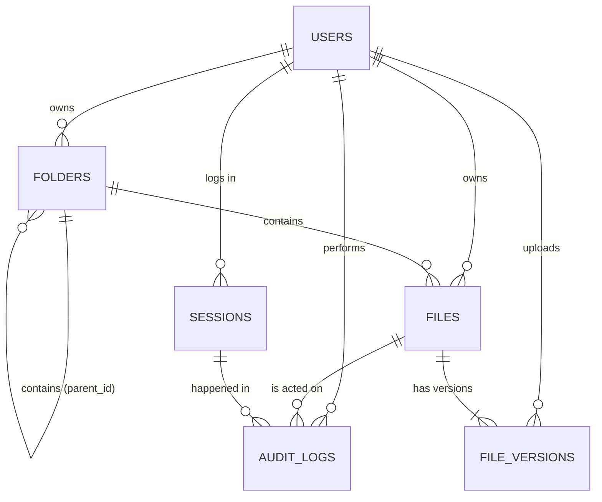

# SentinelVault - Database Design (SQLite)

## ER diagram

## Tables
| Table | Purpose | Key columns |
|---|---|---|
| users | accounts | username (unique), password_hash (BCrypt), role, is_active, failed_attempts, locked_until |
| sessions | one row per login | user_id, token_hash, expires_at, ended_at, end_reason |
| folders | folder tree | name, parent_id (self-reference), owner_id |
| files | file as the user sees it | filename, folder_id, owner_id, access_level, current_version, is_deleted |
| file_versions | each upload = one version, own key | file_id, version_no, stored_path, wrapped_key, sha256 |
| audit_logs | append-only history | user_id, file_id, session_id, action, status, row_hash |

## Rules the database enforces itself
- Role and access level can only be OWNER / EDITOR / VIEWER; status only SUCCESS / DENIED / FAILED.
- Usernames are unique; a folder name is unique within its parent; a folder cannot contain itself.
- A file always has a real owner; a folder that still holds files cannot be deleted.
- A version number is unique per file; sha256 must be 64 characters.
- A trashed file must have a deleted_at date; an ended session must have a reason.
- audit_logs cannot be updated or deleted (triggers), and row_hash chains the rows.

## Why these choices (viva answers)
- **Key per version, in file_versions:** each upload gets its own random AES key, so one leaked key exposes one version only.
- **wrapped_key = '' on delete:** crypto-shredding. The data is unrecoverable even if the .enc file was copied.
- **Session token stored as a hash:** a stolen database does not give working logins.
- **Soft delete + deleted_at:** gives a trash/restore window for folders; for files the key is destroyed on permanent delete.
- **Foreign keys + CHECKs:** bad data is rejected even if application code has a bug.

## Mapping from the current code
| Now (3 tables) | Becomes |
|---|---|
| users.* | same columns + created_at, last_login |
| files.encryption_key | file_versions.wrapped_key |
| files.stored_path | file_versions.stored_path |
| files.owner_id, access_level, is_deleted | same, in files |
| audit_logs | same + session_id, details |
| (new) | sessions, folders, file_versions |
